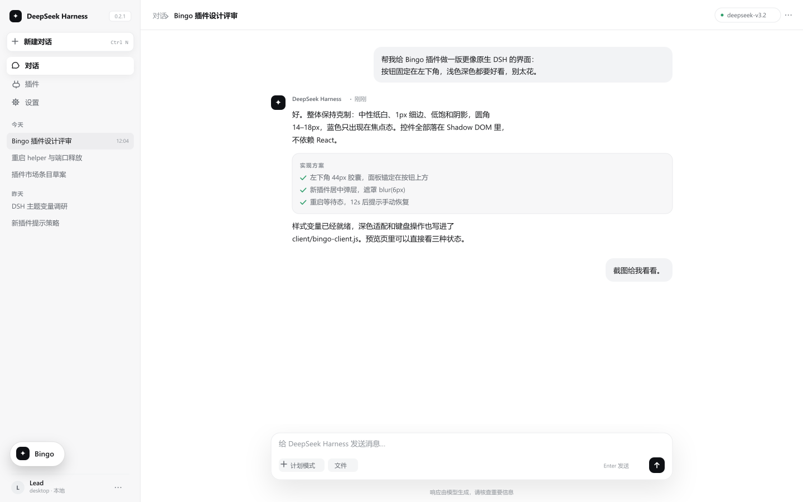
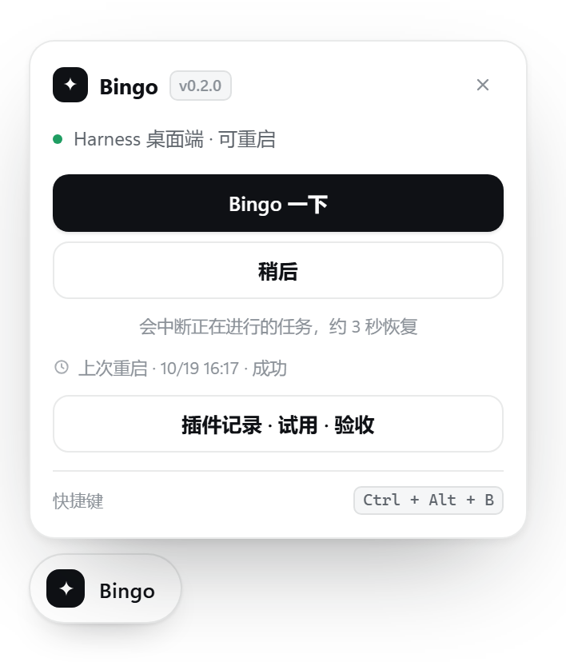
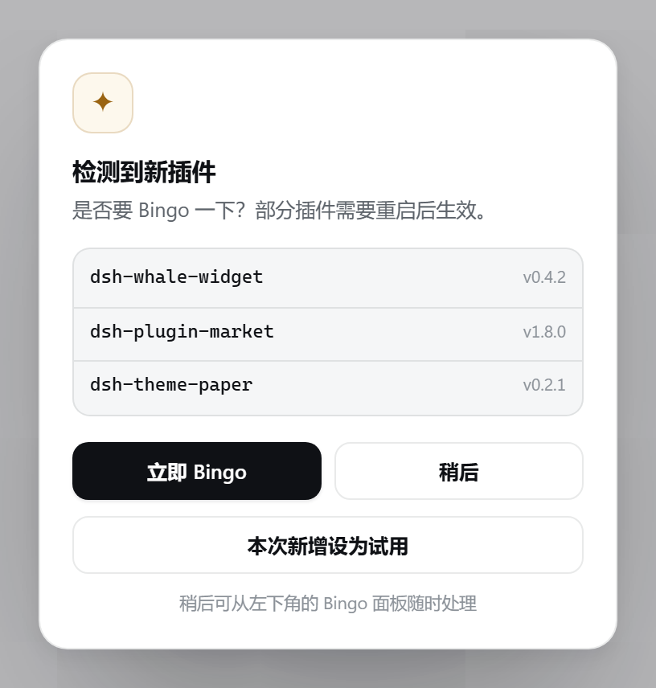
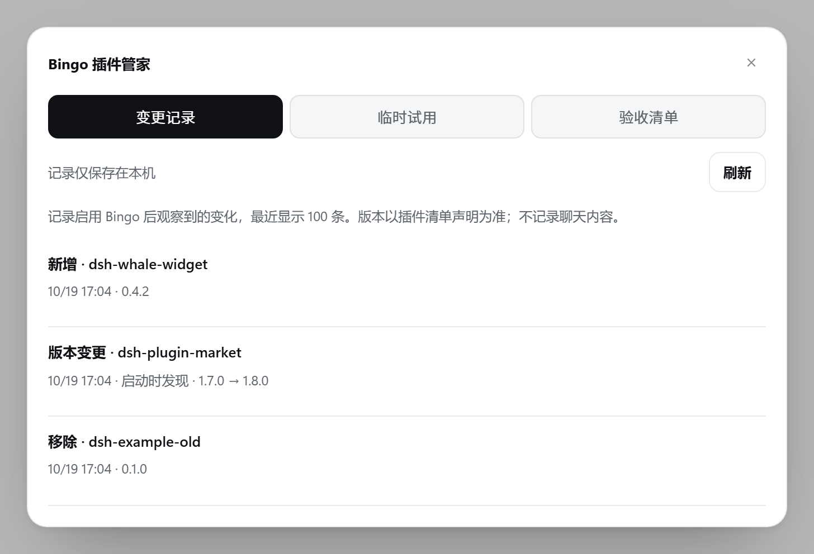
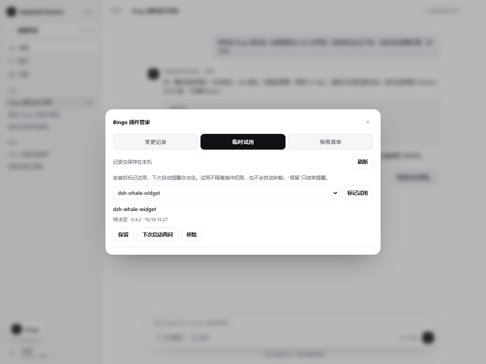
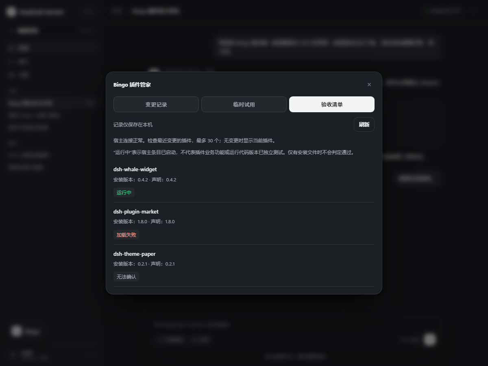

# Bingo — DeepSeek Harness 插件管家

一个可拖动的 Bingo 按钮，集中处理重启提醒、插件变更记录、临时试用和运行状态验收。

[English](README.en.md) · [版本与下载](https://github.com/kongkongya367-glitch/dsh-bingo-ren/releases)

## 功能

- 点击按钮打开面板，再点「Bingo 一下」重启桌面应用。
- 运行期间检测到新插件时弹窗提醒；「稍后」只确认当前这组插件。
- 按钮支持拖动、靠近边缘时吸附，并记住位置。
- `Ctrl+Alt+B` 打开面板，macOS 使用 `Cmd+Alt+B`。
- 插件变更记录跨重启保留，支持安装后标记临时试用。
- 验收清单读取宿主报告的运行状态，帮助排查加载问题。
- 适配深浅色主题，零运行时依赖，无遥测。

## 预览

| 按钮 | 面板 | 新插件提醒 |
| --- | --- | --- |
|  |  |  |

图片使用模拟数据。按钮、面板和弹窗是设计渲染；[拖动示例](assets/screenshot-dragged.png) 是模拟预览页的浏览器截图。

## 安装

在 **设置 → 插件 → 添加插件** 中输入：

```text
dsh-bingo-ren
```

也可使用 [GitHub 仓库地址](https://github.com/kongkongya367-glitch/dsh-bingo-ren) 安装。安装完成后，手动退出并重新打开 DeepSeek Harness 一次，让 Bingo 加载。

运行中的桌面 profile 应通过应用内插件页管理。CLI 仅用于独立的 Web 或测试 profile：

```sh
dsh plugin --profile bingo-selftest add dsh-bingo-ren
```

源码的本地安装方法见 [开发说明](https://github.com/kongkongya367-glitch/dsh-bingo-ren/blob/main/SPEC.md)。

## 使用与限制

点击 Bingo 打开面板，再点「Bingo 一下」即可重启；面板本身就是确认步骤。

**重启会中断正在执行的任务。** 保存工作后再操作。若重启失败，面板会恢复并允许重试；诊断日志位于 `~/.dsh/bingo/restart.log`。

检测到新插件时，可以立即重启，也可以点「稍后」、按 `Esc` 或点击遮罩。应用关闭期间安装的插件会在下次启动时成为基线，不重复提醒。提醒表示插件清单发生新增；是否必须重启取决于插件和宿主的加载方式。

完整重启仅支持官方 Electron 桌面端。在 Web 模式中重启不可用，面板提供刷新页面。

## 插件管家

点击 Bingo 面板中的「插件记录 · 试用 · 验收」打开插件管家。

| 变更记录 | 临时试用 | 验收清单 |
| --- | --- | --- |
|  |  |  |

以上为真实浏览器中的模拟场景，不包含真实账号或插件数据。

### 变更记录

记录安装、清单版本变更和移除，以及试用开始与保留等操作。记录按当前 profile 分开保存在本机，重启后保留；最多保存 200 条，界面展示最近 100 条。首次启用只建立基线，不追溯此前的历史。

版本变更比较的是清单声明，无法发现版本范围不变但锁文件实际解析版本变化的更新。应用关闭期间发生的变化会在下次启动时比较并标记为「启动时发现」。

### 临时试用

- 在「临时试用」中选择已安装插件并标记，或在新插件弹窗点击「本次新增设为试用」。
- 下次启动时提醒选择「保留」「下次启动再问」或「移除」。
- 「保留」只结束试用提醒；「移除」需要再次确认，并交由 Harness 原生插件管理器处理。
- 安装声明变更后必须重新标记，避免误删替换后的版本。Bingo 本身不支持试用移除。

试用不隔离插件权限，也不会自动删除插件。宿主不支持移除、插件受到保护或仍被占用时，请到 Harness 插件页处理。依赖清理由宿主管理器负责，插件产生的数据是否清理由该插件决定。

### 验收清单

展示最近变更的插件，最多 30 个；无变更时检查当前插件。根据宿主插件管理接口显示：运行中、加载失败、已禁用、等待启动或无法确认。

「运行中」仅说明对应的宿主条目已启动，不代表业务功能或运行代码版本已独立测试。仅有安装文件、仅客户端插件或宿主未提供足够信息时，不会误报为通过。点击「刷新」重新读取当前状态。

## 配置

在 profile 的 `cordis.patch.yml` 中配置：

```yaml
- id: dsh-bingo-ren
  config:
    enabled: true
    pollMs: 4000           # 检测间隔，1500–60000 毫秒
    allowRestart: true
    position: bottom-left # 或 bottom-right
    debug: false
```

`confirm` 为保留选项；当前版本始终先显示面板。

## 卸载

在 **设置 → 插件** 中移除 Bingo，再重启一次应用。若使用源码中的本地安装脚本，请先退出应用，再执行：

```powershell
powershell -NoProfile -ExecutionPolicy Bypass -File scripts/install-local-desktop.ps1 -Uninstall
```

本地卸载只移除 Bingo 的依赖、bundle 条目和包目录，保留其他插件配置。可选删除 `~/.dsh/bingo/` 清理检测状态与日志。

## 隐私与兼容性

Bingo 读取本地 profile 清单及宿主插件状态，界面访问同源 `/bingo/*` 接口。变更记录、试用状态与日志仅保存在本机，不记录聊天，不发送遥测。用户确认移除时，由宿主管理器执行包管理操作，可能涉及其配置的注册表。

需要 Node.js 20+、DeepSeek Harness 0.2.0-rc.1+。使用公开 Cordis 接口，不修改 DSH 核心。

## 排查

- 没有按钮：首次安装后手动重启，确认插件已启用。
- 重启不可用：确认是桌面端，且 `allowRestart` 未关闭。
- 重启失败：查看 `~/.dsh/bingo/restart.log`，排除可执行文件或权限问题后重试。

[MIT License](LICENSE)
